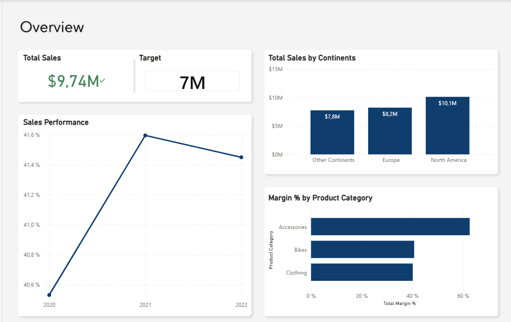
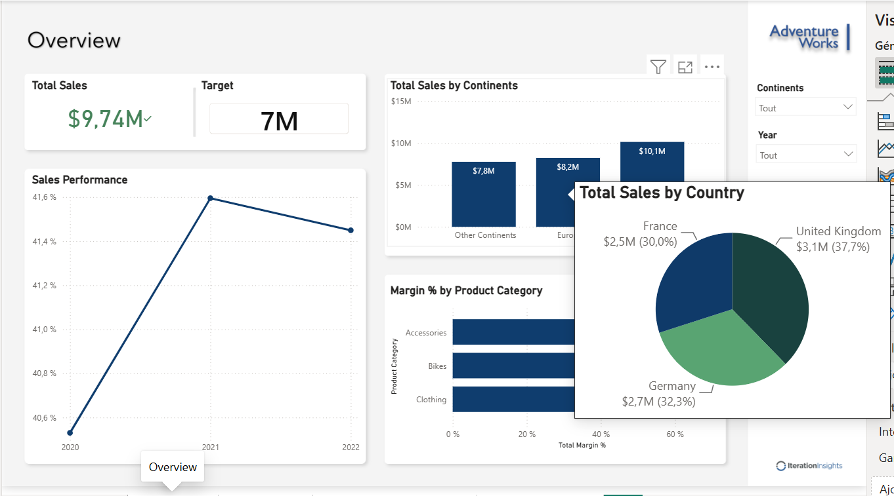
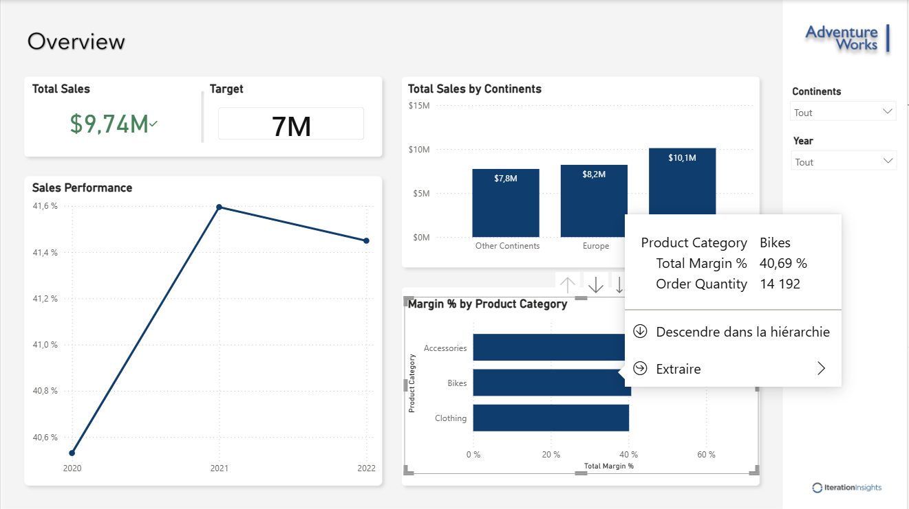

# Adventure Works | Sales & Margin Analysis with Power BI

**An interactive training report exploring sales performance across time, products and territories.**

By **Thierry Pascal Zokou Tchokonthe**, Junior Data Analyst with a finance and accounting background. Built as part of the Microsoft Press *Introduction to Microsoft Power BI*, second edition, training course.

[Français](README.md) · [Download the PBIX](sales.pbix) · [Setup guide](GUIDE.md) · [Portfolio](https://tzokou.github.io/)

## Context & objectives

The report brings together sales, margin rates and time comparisons to explore three questions: which territories contribute most to displayed sales, which product categories have the highest margin rates, and how can users move from an overview to country and product details?

## Tools & deliverables

- **Power BI Desktop:** a four-page PBIX report, filters, hierarchies and visual exploration.
- **DAX:** referenced measures for sales, margin, orders, year-to-date sales and prior-year comparisons. Expressions have not been audited.
- **Excel:** sales files and product/territory reference files supplied by the course.
- **Power Query:** part of the course's data preparation workflow; exact transformations in the final file are not documented here.

| Page | Purpose |
|---|---|
| Overview | Sales, target, continent comparison, margin by product category, margin trend and year/continent filters |
| Dax Demo | Tabular exploration of sales, margin, order and order-line measures |
| Product Sales Details | Product subcategory analysis with YTD, prior-year sales and year-over-year percentage change |
| Sales Regions | Country breakdown, also shown in geographic report tooltips |

## Findings visible in the screenshots

- **North America leads the displayed geographic groups:** $10.1M versus $8.2M for Europe and $7.8M for Other Continents.
- **Accessories have the highest displayed margin rate:** over 60%, versus roughly 40% for Bikes and Clothing. This does not establish the largest absolute profit contribution.
- **Margin rises from about 40.5% in 2020 to 41.6% in 2021, then eases to about 41.45% in 2022.** Causes require further investigation.
- **Within the Europe tooltip**, the United Kingdom represents 37.7%, Germany 32.3% and France 30.0%.
- **The Bikes tooltip shows a 40.69% margin rate and 14,192 units.**

**Scope matters:** the KPI displays $9.74M against a 7M target, while geographic bars sum to about $26.1M. The KPI definition contains an annual trend axis, so a different time context is a possible explanation, not a verified conclusion. These figures are not treated as reconciled totals, and no target-attainment rate is claimed. The screenshots use a $ symbol without identifying a currency code.

## Results & value

The deliverable combines a commercial overview, geographic detail and time-based product analysis. It demonstrates applied financial reasoning, interactive reporting and careful communication of scope. This is an educational project; no measured business, revenue or productivity impact is claimed.

## Opening the report

Download `sales.pbix` and open it in Power BI Desktop. For refresh, obtain the course data and update local source paths as explained in [GUIDE.md](GUIDE.md). GitHub hosts the file and screenshots, not an executable Power BI report.

## Attribution

Based on [Iteration Insights / Microsoft Press course resources](https://github.com/IterationInsights/Microsoft-Press-Introduction-to-Microsoft-Power-BI-V2). Training data, backgrounds and exercises are not claimed as original work. See [ATTRIBUTION.md](ATTRIBUTION.md) and the French [methodology notes](METHODOLOGIE.md).

[GitHub](https://github.com/tzokou) · [Portfolio](https://tzokou.github.io/) · [LinkedIn](https://www.linkedin.com/in/thierry-pascal-zokou-tchokonthe-b46655184/)
