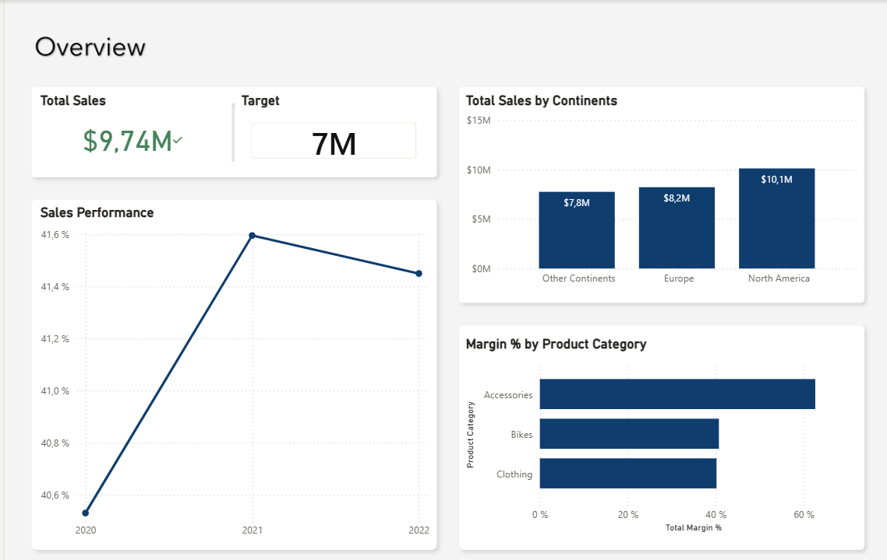
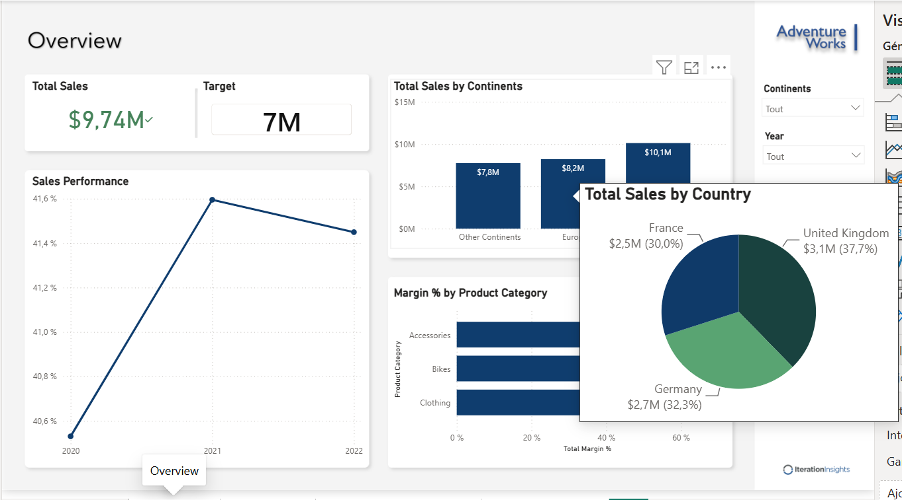
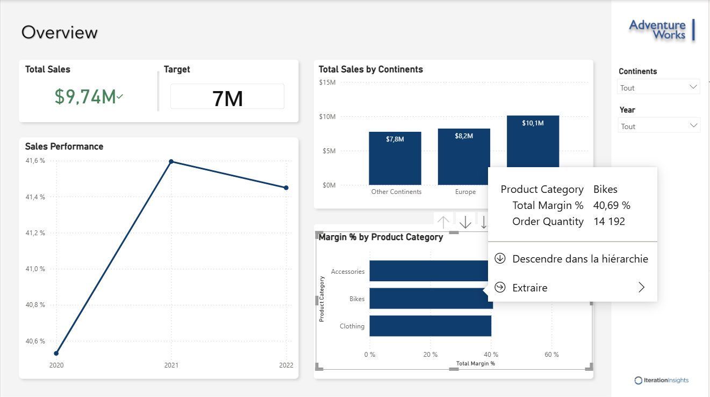
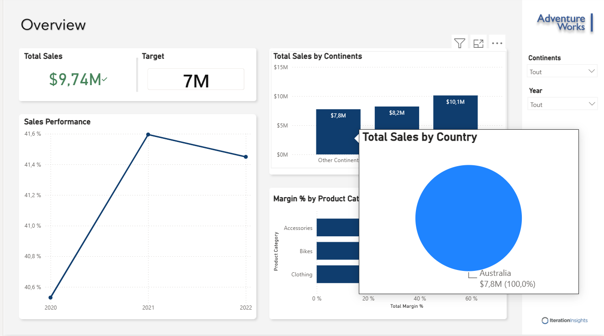

> **Nouveau projet : [European Sales Report — Performance commerciale et scénarios Power BI](european-sales-report/README.md)**  
> Projet réalisé dans le cadre de la Power BI Masterclass de Cekou Coulibaly (Udemy). [Captures, présentation et fichier PBIX](european-sales-report/).

---

# Adventure Works | Analyse des ventes et de la marge avec Power BI

**Un rapport interactif pour explorer la performance commerciale par période, produit et territoire.**

Projet de formation de **Thierry Pascal Zokou Tchokonthe**, réalisé à partir du parcours Microsoft Press *Introduction to Microsoft Power BI*, 2e édition, et de ses ressources Adventure Works. Cette étude de cas met en pratique l’analyse financière, la visualisation et l’exploration des données dans Power BI.

[English version](README.en.md) · [Télécharger le rapport Power BI](sales.pbix) · [Guide d’ouverture](GUIDE.md) · [Définitions et limites](METHODOLOGIE.md) · [Portfolio](https://tzokou.github.io/)



*Capture réelle du rapport, fournie par l’auteur. Les chiffres sont ceux de l’état affiché ; la devise est représentée par le symbole $ dans le rapport.*

## Contexte & objectifs

Une vue synthétique des ventes ne suffit pas à comprendre les différences entre marchés ou entre familles de produits. Le projet propose une lecture complémentaire des **ventes**, du **taux de marge** et de leur **évolution temporelle** pour répondre à trois questions :

- Quels territoires contribuent le plus aux ventes affichées ?
- Quelles catégories présentent les taux de marge les plus élevés ?
- Comment explorer les résultats d’une vue globale jusqu’au détail des produits et des pays ?

Le rapport sert de support pédagogique à l’analyse et à la restitution. Il ne correspond pas à un déploiement opérationnel en entreprise.

## Outils & technologies

| Outil | Utilisation dans le projet |
|---|---|
| **Power BI Desktop** | Rapport PBIX, visualisations, segments, hiérarchies et navigation |
| **DAX** | Mesures référencées pour les ventes, la marge, les commandes, le cumul annuel et la comparaison à l’année précédente |
| **Excel** | Fichiers de ventes par pays et période ; référentiels produits et territoires fournis par la formation |
| **Power Query** | Préparation des données dans le parcours de formation ; les étapes exactes du fichier final ne sont pas reproduites dans ce dépôt |

La présence des mesures DAX est vérifiée dans la définition des visuels. Leurs expressions et les relations du modèle n’ont pas été auditées ; voir la [note méthodologique](METHODOLOGIE.md).

## Principales réalisations

| Page du rapport | Contenu | Question d’analyse |
|---|---|---|
| **Overview** | Ventes, objectif, répartition par continent, marge par catégorie et évolution temporelle ; segments continent/année | Comment lire la performance globale et la comparer entre segments ? |
| **Dax Demo** | Tableau de mesures de ventes, de marge, de commandes et de lignes de commande | Comment réunir plusieurs indicateurs dans un tableau de contrôle pédagogique ? |
| **Product Sales Details** | Ventes par sous-catégorie et période, cumul annuel (YTD), ventes de l’année précédente et variation annuelle (YoY) | Comment approfondir l’analyse produit et comparer les périodes ? |
| **Sales Regions** | Répartition des ventes par pays ; détail géographique visible en infobulle sur les captures | Quels pays composent la contribution d’un continent ? |

### Explorer les territoires



*L’infobulle géographique complète le graphique par continent sans quitter la page de synthèse.*

### Approfondir l’analyse produit



*La capture montre la marge et la quantité de la catégorie Bikes, ainsi que les options de navigation vers davantage de détail.*

<details>
<summary>Voir également l’infobulle du groupe « Other Continents »</summary>



Le 100 % affiché concerne uniquement le contexte de cette infobulle ; il ne représente pas la part mondiale de l’Australie.

</details>

## Analyses clés visibles dans les captures

| Observation | Élément de preuve | Lecture métier |
|---|---|---|
| **L’Amérique du Nord arrive en tête des groupes géographiques affichés** | 10,1 M$, devant l’Europe à 8,2 M$ et « Other Continents » à 7,8 M$ | Comparer ensuite les pays, les périodes et le mix produit avant de fixer des priorités commerciales |
| **Les accessoires présentent le taux de marge le plus élevé** | Barre supérieure à 60 %, contre environ 40 % pour Bikes et Clothing | Examiner aussi les volumes et la marge en valeur : un taux élevé ne suffit pas à établir la contribution totale |
| **La marge progresse entre 2020 et 2021, puis recule légèrement en 2022** | Courbe allant d’environ 40,5 % à 41,6 %, puis 41,45 % | Approfondir les variations par produit et territoire ; les captures ne permettent pas d’en identifier les causes |
| **Le Royaume-Uni est le premier contributeur dans l’infobulle Europe** | Royaume-Uni : 37,7 % ; Allemagne : 32,3 % ; France : 30,0 % | Lire ces proportions à l’intérieur du périmètre européen survolé |
| **La catégorie Bikes associe marge et volume** | Taux de marge : 40,69 % ; quantité : 14 192 | Mettre le taux en perspective avec les volumes pour préparer une analyse de contribution |

**Point de lecture à connaître :** la carte KPI affiche **9,74 M$** face à un objectif de **7 M**, alors que les trois barres géographiques totalisent environ **26,1 M$**. Le visuel KPI utilise un axe annuel dans sa définition ; un contexte temporel différent est une explication possible, à confirmer dans Power BI. Ces valeurs ne sont donc pas présentées comme un total réconcilié, et aucun taux d’atteinte de l’objectif n’est revendiqué. Les captures avec segments visibles indiquent « Tout » pour le continent et l’année.

## Résultats & valeur ajoutée

- **Un rapport de quatre pages** associant synthèse, analyse produit, exploration géographique et mesures temporelles.
- **Une lecture financière des données commerciales** : les ventes sont mises en regard des taux de marge et des volumes.
- **Une exploration progressive** avec filtres, infobulles et hiérarchies pour passer d’un constat global à une question plus précise.
- **Une restitution documentée** distinguant les observations, leur périmètre et les vérifications à poursuivre.

La valeur démontrée est celle du livrable et des compétences mises en pratique. Aucun gain de chiffre d’affaires, de rentabilité ou de productivité en entreprise n’a été mesuré.

## Consulter et reproduire

1. Parcourir les captures et la documentation directement dans GitHub.
2. Télécharger [`sales.pbix`](sales.pbix) puis l’ouvrir dans Power BI Desktop.
3. Pour actualiser les données, récupérer les ressources originales et adapter les chemins selon le [guide](GUIDE.md).
4. Contrôler le périmètre des filtres et les définitions des indicateurs avant toute comparaison chiffrée.

GitHub fournit les fichiers et les captures ; il n’exécute pas le rapport Power BI dans la page du dépôt.

## Structure du dépôt

```text
README.md                       Présentation en français
README.en.md                    Présentation en anglais
sales.pbix                      Rapport Power BI de formation
overview.png                    Capture de synthèse
country-tooltip-europe.png      Détail géographique Europe
country-tooltip-australia.png   Détail géographique Australia
product-drillthrough.png        Exploration de la catégorie Bikes
GUIDE.md                        Ouverture et actualisation
METHODOLOGIE.md                  Indicateurs, périmètre et limites
ATTRIBUTION.md                  Ressources pédagogiques et crédits
report-structure.json           Inventaire des pages et champs des visuels
```

## Auteur & crédits

**Thierry Pascal Zokou Tchokonthe** — Analyste de données junior, parcours finance et comptabilité, formation en sciences des données appliquées.

[GitHub](https://github.com/tzokou) · [Portfolio](https://tzokou.github.io/) · [LinkedIn](https://www.linkedin.com/in/thierry-pascal-zokou-tchokonthe-b46655184/)

Ressources pédagogiques : [Iteration Insights — Microsoft Press Introduction to Microsoft Power BI V2](https://github.com/IterationInsights/Microsoft-Press-Introduction-to-Microsoft-Power-BI-V2). Le jeu de données, les éléments visuels et les exercices proviennent de ce parcours. Ce dépôt présente le travail de formation de l’auteur, ses captures et la documentation de son livrable ; il ne revendique pas la création originale du cas Adventure Works. Voir les [crédits](ATTRIBUTION.md).

