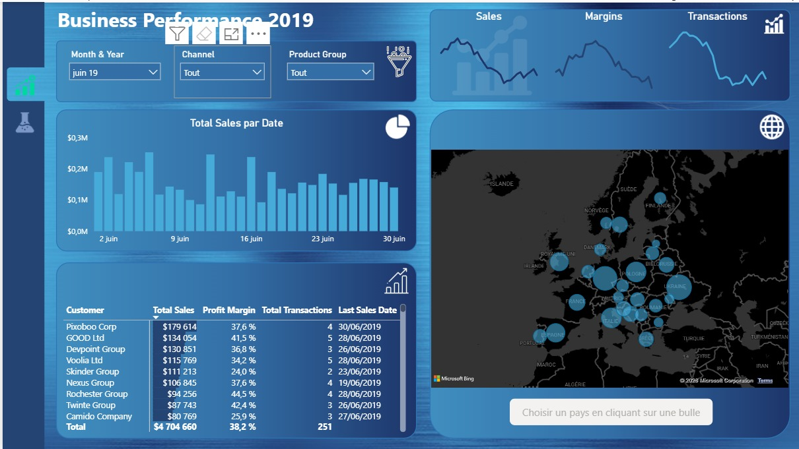
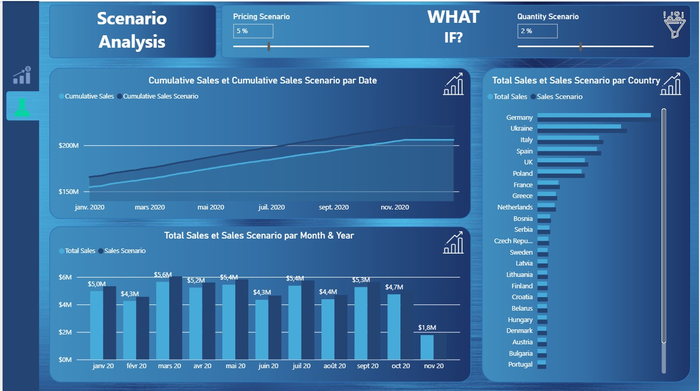
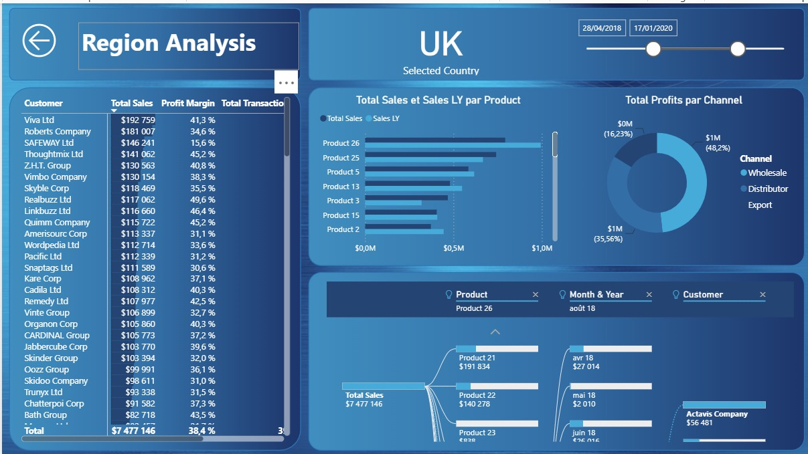

# European Sales Report | Performance commerciale & scénarios Power BI

**Explorer les ventes, la rentabilité et l’effet d’hypothèses de prix et de volume dans un rapport interactif.**

Projet de formation de **Thierry Pascal Zokou Tchokonthe**, réalisé dans le cadre de la [Power BI Masterclass — Intermédiaires et Avancés](https://www.udemy.com/course/microsoft-power-bi-masterclass-intermediaires-et-avances/), de **Cekou Coulibaly**, sur Udemy. Le cas pratique, les données et les éléments de design sont issus des ressources pédagogiques du parcours. Ce dépôt présente ma mise en pratique et mon livrable de formation.

[Télécharger le rapport Power BI](European%20Sales%20Report.pbix) · [Portfolio](https://tzokou.github.io/#european-sales) · [Publication LinkedIn préparée](LINKEDIN.md)

*Capture réelle fournie par l’auteur : juin 2019, canal et groupe de produits sur « Tout ». Le rapport affiche les montants avec le symbole $ ; le périmètre géographique ne signifie pas que la devise est l’euro.*

## Objectif du projet

Construire une lecture complémentaire de la performance commerciale : suivre l’activité, approfondir les résultats par pays et explorer des hypothèses commerciales. Les questions traitées sont :

- Comment évoluent les ventes et quels clients composent les résultats du périmètre sélectionné ?
- Comment comparer les produits, les canaux et les territoires ?
- Comment les ventes simulées évoluent-elles lorsque l’on ajuste les hypothèses de prix et de quantité ?

## Trois pages complémentaires

| Page | Fonctionnalités présentes | Utilité analytique |
|---|---|---|
| **Business Performance** | Ventes par date, matrice clients, taux de marge, transactions, dernière date de vente, carte par pays et tendances sur moyennes mobiles de 14 jours ; filtres période, canal et groupe de produits | Lire la performance commerciale dans un contexte de filtre explicite |
| **Scenario Analysis** | Paramètres de prix et de quantité, comparaison ventes/scénario par mois et par pays, courbes cumulées | Explorer la sensibilité des ventes aux hypothèses sélectionnées |
| **Region Analysis** | Page de drill-through par pays, filtre de dates, ventes et ventes N−1 par produit, profits par canal, matrice clients et arbre de décomposition | Passer d’une synthèse géographique à une analyse détaillée |

### Explorer des hypothèses commerciales

*La capture montre une hypothèse de prix de +5 % et de quantité de +2 %. Il s’agit d’une simulation pédagogique, pas d’une hausse observée ou d’une prévision validée. La page est filtrée sur 2020 dans la définition du rapport.*

### Approfondir le détail régional

*La capture affiche UK et une plage de dates du 28/04/2018 au 17/01/2020. Son périmètre diffère de celui de la page Business Performance ; les totaux de ces captures ne doivent pas être comparés directement.*

## Compétences mises en pratique

- **Power Query et données Excel** : préparation des sources dans le cadre du parcours de formation.
- **Modélisation** : organisation des tables Sales, Customers, Products, Regions et Dates ; tables de mesures et paramètres de scénario présents dans le fichier.
- **DAX** : indicateurs de ventes, marge et transactions ; mesures de moyennes mobiles sur 14 jours, comparaisons à l’année précédente et ventes de scénario référencées par les visuels.
- **Visualisation et navigation** : segments, carte, matrices, graphiques temporels, drill-through et arbre de décomposition.
- **Communication analytique** : séparation entre performance observée dans les données d’exercice et résultats simulés.

## Périmètre de vérification et limites

La présence des pages, champs et mesures a été vérifiée dans la définition du PBIX et dans les captures. Les supports des modules ont servi à comprendre le contexte pédagogique ; ils ne prouvent pas à eux seuls qu’une étape a été réalisée.

Les expressions DAX, les relations et les transformations Power Query n’ont pas fait l’objet d’un audit exhaustif. En particulier, le périmètre historique de la courbe cumulée doit être contrôlé avant de l’interpréter comme un cumul limité à 2020. Aucun taux d’amélioration commerciale ou gain de productivité réel n’est revendiqué.

## Ouvrir le rapport

1. Télécharger le fichier `European Sales Report.pbix` et l’ouvrir dans Power BI Desktop.
2. Parcourir Business Performance et Scenario Analysis ; ouvrir le détail régional avec le drill-through par pays. Region Analysis est une page de détail masquée en mode lecture.
3. Pour actualiser le modèle, disposer des sources de formation et adapter leurs chemins locaux dans les paramètres de source de données ou Power Query. Les fichiers Excel et PDF de cours ne sont pas redistribués ici.
4. Vérifier les filtres, les dates et les définitions des mesures avant toute comparaison.

GitHub héberge le fichier et les captures ; il n’exécute pas le rapport Power BI. Aucun lien Power BI Service public n’est fourni.

## Auteur et attribution

**Thierry Pascal Zokou Tchokonthe** — Finance, comptabilité et analyse de données.

[GitHub](https://github.com/tzokou) · [Portfolio](https://tzokou.github.io/) · [LinkedIn](https://www.linkedin.com/in/thierry-pascal-zokou-tchokonthe-b46655184/)

Formation : **Cekou Coulibaly — Power BI Masterclass, Intermédiaires et Avancés (Udemy)**. Les supports identifient le cas « European Sales Report » et Reporting Savvy. Je ne revendique pas la création originale du cas, des données ou des arrière-plans pédagogiques. Aucune licence de réutilisation des ressources de formation n’est accordée par ce dépôt.
